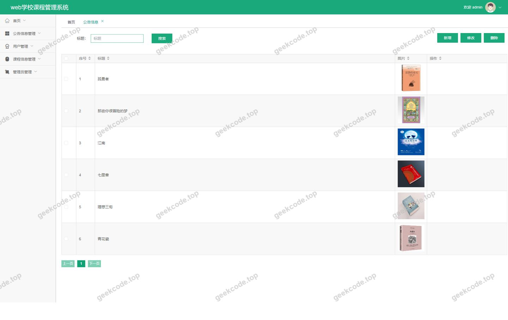
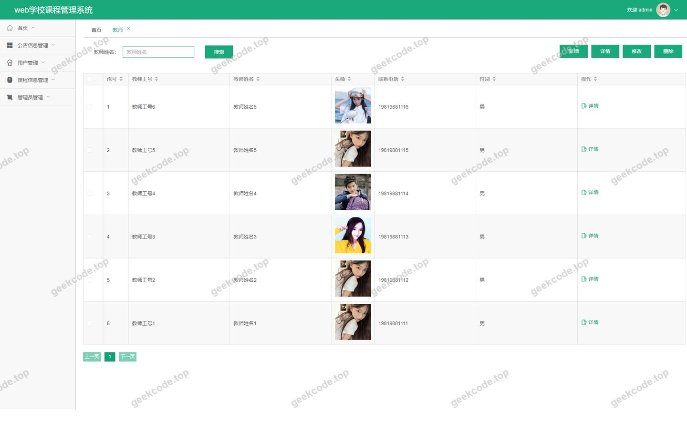
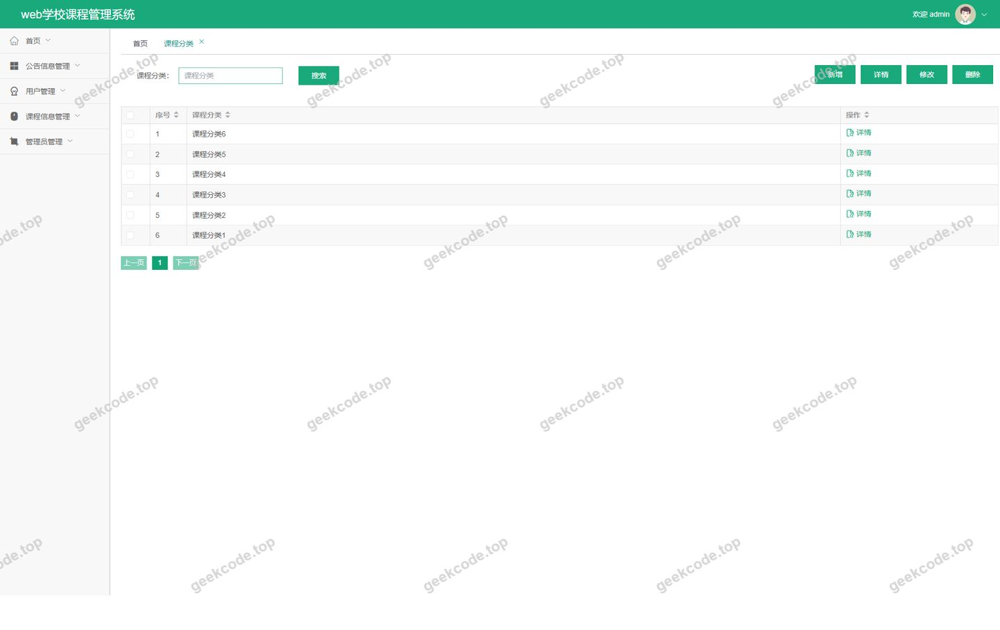
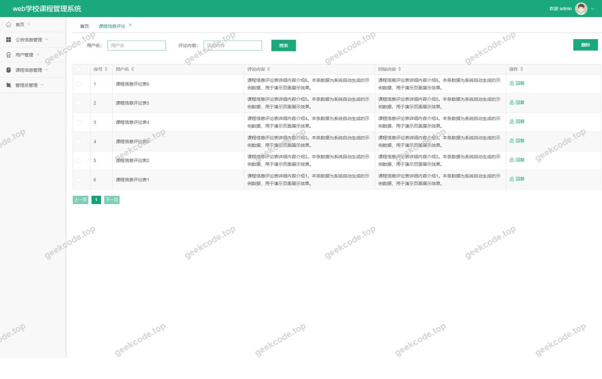
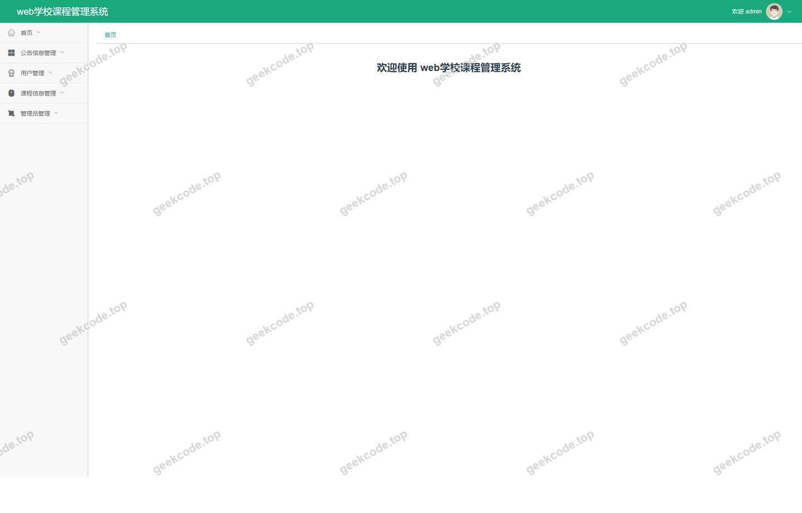
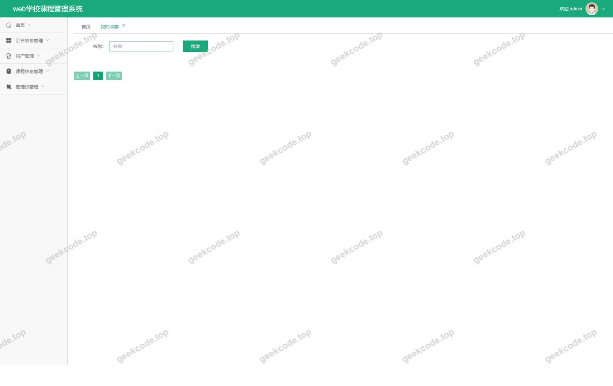
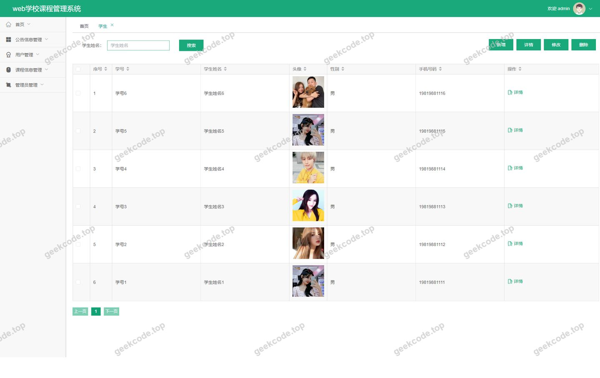

# web学校课程管理系统

> 🎓 **计算机毕业设计 · web学校课程管理系统**
>
> 本仓库只放**项目介绍 + 运行截图**（截图是站点带水印的原图，存在仓库 `images/` 里）。
>
> 👉 **完整可运行源码 / 数据库脚本 / 部署文档：[点我获取](https://geekcode.top/archives/web%E5%AD%A6%E6%A0%A1%E8%AF%BE%E7%A8%8B%E7%AE%A1%E7%90%86%E7%B3%BB%E7%BB%9F?utm_source=github)**
>
> 💬 咨询微信：**ir9372**　|　🌐 更多项目：[极客代码 geekcode.top](https://geekcode.top/?utm_source=github)
>
> 📌 项目详情页：<https://geekcode.top/archives/web%E5%AD%A6%E6%A0%A1%E8%AF%BE%E7%A8%8B%E7%AE%A1%E7%90%86%E7%B3%BB%E7%BB%9F?utm_source=github>

<table><td width="230" align="center"> <b>扫码加微信 ir9372</b></td><td valign="middle">📦 源码 = 项目介绍 + 全部运行截图 + 数据库 + 部署文档 👉 点上方任意截图，直接跳到 <b>极客代码 geekcode.top</b> 详情页</td></table>

---

<h1>web学校课程管理系统</h1>
<h2>项目概述</h2>

本项目为“web学校课程管理系统”，旨在构建一个基于前后端分离架构的在线教学管理平台。系统核心功能涵盖课程信息管理、教师与学生档案管理、课程分类维护以及公告发布等模块。通过整合前台用户交互界面与后台管理控制台，实现了对学校课程资源的数字化管控。适用人群主要包括学校管理员、授课教师及在校学生。技术架构上采用 Spring Boot 作为后端基础框架，结合 MyBatis-Plus 进行数据持久层开发，并使用 Shiro 框架保障系统安全性；前端采用 Vue 技术栈实现页面渲染与路由跳转，确保了良好的用户体验与系统可维护性。

<h2>技术架构</h2>

本项目采用典型的前后端分离架构设计，具体技术选型与架构描述如下：

<h3>1. 后端架构</h3>
<ul>
<li><strong>核心框架</strong>：使用 <code>spring-boot-starter-web</code> 构建 RESTful API 接口，提供稳定的 Web 服务支持。</li>
<li><strong>持久层框架</strong>：集成 <code>mybatis-plus</code> 与 <code>mybatis-spring-boot-starter</code>，简化 CRUD 操作代码编写，提升数据库访问效率。同时引入 <code>spring-boot-starter-jdbc</code> 和 <code>mysql-connector-java</code> 确保与 MySQL 数据库的高效连接。</li>
<li><strong>安全认证</strong>：采用 <code>shiro-spring</code> 进行权限管理与身份认证，保障后台管理接口的安全性，防止未授权访问。</li>
<li><strong>工具类库</strong>：引入 <code>commons-lang3</code> 处理通用字符串与对象操作，<code>validation-api</code> 用于参数校验，<code>protobuf-java</code> 用于高效的数据序列化传输。</li>
</ul>
<h3>2. 前端架构</h3>
<ul>
<li><strong>框架选型</strong>：基于 Vue.js 生态构建单页应用（SPA），通过 <code>vue-separate</code> 模式实现前后端解耦。</li>
<li><strong>路由管理</strong>：前端定义了两套独立的路由体系。</li>
<li><strong>后台路由</strong>：包括 <code>/jiaoshiCenter</code>（教师中心）、<code>/news</code>（新闻/公告）、<code>/xuesheng</code>（学生管理）、<code>/kechengfenlei</code>（课程分类）、<code>/jiaoshi</code>（教师管理）、<code>/storeup</code>（收藏）、<code>/discusskechengxinxi</code>（课程评论）、<code>/kechengxinxi</code>（课程信息）、<code>/kechengxuexi</code>（课程学习）及 <code>/config</code>（配置）。</li>
<li><strong>前台路由</strong>：涵盖首页列表展示（如 <code>/index/storeupList</code>, <code>/index/jiaoshiList</code> 等）、详情页查看、新增编辑页面以及注册登录入口（<code>/xueshengRegister</code>）。</li>
</ul>
<h3>3. 数据库设计要点</h3>
<ul>
<li><strong>存储引擎</strong>：选用 MySQL 关系型数据库。</li>
<li><strong>实体映射</strong>：利用 MyBatis-Plus 的 ORM 特性，将 Java 实体类直接映射至数据库表结构，主要涉及学生、教师、课程、课程分类、公告、收藏记录及评论信息等核心业务表。</li>
</ul>
<h2>功能模块</h2>

根据源码路由配置及截图所示，系统功能划分为前台用户端与后台管理端两大板块。

<h3>1. 前台用户端功能</h3>

前台主要面向普通用户（学生、教师访客等），提供信息浏览、检索及个人业务办理功能。

<ul>
<li><strong>首页与信息展示</strong>：</li>
<li><strong>课程信息列表/详情/新增</strong> (<code>/index/kechengxinxiList</code> 等)：用户可浏览课程概况，查看详情，并在特定权限下提交新课程信息。</li>
<li><strong>教师列表/详情/新增</strong> (<code>/index/jiaoshiList</code> 等)：展示教师基本信息，支持查看教师主页及录入新教师资料。</li>
<li><strong>课程分类列表/详情/新增</strong> (<code>/index/kechengfenleiList</code> 等)：按类别筛选课程，查看分类详情及管理分类条目。</li>
<li><strong>课程学习列表/详情/新增</strong> (<code>/index/kechengxuexiList</code> 等)：记录与管理学生的学习进度或选课信息。</li>
<li><strong>学生列表/详情/新增</strong> (<code>/index/xueshengList</code> 等)：展示学生档案信息，支持学生资料的增删改查。</li>
<li><strong>公告信息列表</strong> (<code>/index/newsList</code>)：展示学校发布的最新通知与公告。</li>
<li><strong>个人业务功能</strong>：</li>
<li><strong>我的收藏</strong> (<code>/index/storeupList</code>)：用户可查看自己收藏的课程或教师资源。</li>
<li><strong>学生注册</strong> (<code>/xueshengRegister</code>)：新用户可通过此页面完成账号注册。</li>
<li><strong>学生个人中心</strong> (<code>/index/xueshengCenter</code>)：已登录学生可进入专属中心管理个人信息及相关业务。</li>
</ul>
<h3>2. 后台管理端功能</h3>

后台主要面向系统管理员，提供全局数据监控、内容审核及系统配置功能。

<ul>
<li><strong>系统登录与首页</strong>：管理员通过专用登录页进入后台首页，概览系统运行状态。</li>
<li><strong>基础数据管理</strong>：</li>
<li><strong>学生管理</strong> (<code>/xuesheng</code>)：对学生信息进行全量维护。</li>
<li><strong>教师管理</strong> (<code>/jiaoshi</code>)：对教师档案进行审核与维护。</li>
<li><strong>课程分类管理</strong> (<code>/kechengfenlei</code>)：配置课程的分类标签体系。</li>
<li><strong>课程信息管理</strong> (<code>/kechengxinxi</code>)：审核并发布课程详细内容。</li>
<li><strong>互动与内容管理</strong>：</li>
<li><strong>课程评论管理</strong> (<code>/discusskechengxinxi</code>)：查看并管理用户对课程的评论反馈。</li>
<li><strong>公告信息管理</strong> (<code>/news</code>)：发布、编辑或删除校园公告。</li>
<li><strong>收藏记录管理</strong> (<code>/storeup</code>)：监控系统内的收藏行为数据。</li>
<li><strong>其他功能</strong>：</li>
<li><strong>教师中心</strong> (<code>/jiaoshiCenter</code>)：可能为教师提供的独立管理视图或数据汇总入口。</li>
<li><strong>系统配置</strong> (<code>/config</code>)：对系统参数进行基础设置。</li>
</ul>
<h2>用户角色与权限</h2>

基于 Shiro 安全框架及路由划分，系统主要存在以下三类角色及其对应权限：

<table>
<thead>
<tr>
<th align="left">角色</th>
<th align="left">权限范围</th>
<th align="left">可访问模块</th>
</tr>
</thead>
<tbody><tr>
<td align="left"><strong>系统管理员 (Admin)</strong></td>
<td align="left">拥有最高权限，负责全局数据维护、内容审核及系统配置。</td>
<td align="left"><strong>后台所有路由</strong>：- 后台登录页- 后台首页- 学生管理 (<code>/xuesheng</code>)- 教师管理 (<code>/jiaoshi</code>)- 课程分类 (<code>/kechengfenlei</code>)- 课程信息 (<code>/kechengxinxi</code>)- 课程评论 (<code>/discusskechengxinxi</code>)- 公告信息 (<code>/news</code>)- 收藏记录 (<code>/storeup</code>)- 教师中心 (<code>/jiaoshiCenter</code>)- 系统配置 (<code>/config</code>)</td>
</tr>
<tr>
<td align="left"><strong>学生 (Student)</strong></td>
<td align="left">主要进行信息查询、个人资料维护及课程相关操作。</td>
<td align="left"><strong>前台部分路由</strong>：- 学生注册 (<code>/xueshengRegister</code>)- 学生个人中心 (<code>/index/xueshengCenter</code>)- 浏览各类列表与详情（课程、教师、分类、公告等）- 新增/编辑个人关联数据（视具体业务逻辑而定，如提交课程信息、收藏等）</td>
</tr>
<tr>
<td align="left"><strong>教师 (Teacher)</strong></td>
<td align="left">侧重于课程内容的发布与维护，以及个人信息的展示。</td>
<td align="left"><strong>前台/混合路由</strong>：- 教师中心 (<code>/jiaoshiCenter</code> - 亦出现在后台路由中，推测为教师专属管理界面)- 浏览与查询前台公开信息- 新增/编辑课程信息 (<code>/index/kechengxinxiAdd</code> 等)- 新增/编辑教师信息 (<code>/index/jiaoshiAdd</code> 等)</td>
</tr>
</tbody></table>

<em>注：具体按钮级权限控制需依据 Shiro 注解在 Controller 层的实际实现确定，此处仅依据路由与菜单结构推导宏观权限边界。</em>

<h2>项目特色与创新点</h2>
<ol>
<li><strong>严格的前后端分离架构</strong>：采用 Vue + Spring Boot 组合，实现了界面渲染与业务逻辑的物理隔离，提升了系统的可扩展性与团队协作效率。</li>
<li><strong>完善的权限管理体系</strong>：集成 Apache Shiro 框架，针对管理员、教师、学生等不同角色设计了差异化的访问控制策略，有效保障了校园敏感数据的安全性。</li>
<li><strong>高效的持久层开发</strong>：引入 MyBatis-Plus 框架，大幅减少了传统 XML 配置文件的冗余，通过代码生成器与通用 Mapper 实现了快速开发，降低了维护成本。</li>
<li><strong>多维度的课程资源管理</strong>：不仅包含基础的课程信息录入，还引入了“课程分类”、“课程评论”及“收藏”机制，构建了从资源发布到用户反馈的完整闭环，增强了系统的互动性与实用性。</li>
<li><strong>灵活的模块化设计</strong>：后台路由清晰划分了“配置”、“中心”、“列表”等功能域，便于后续功能的横向扩展与垂直深化。</li>
</ol>
<h2>部署环境</h2>

为确保系统正常运行，建议准备以下软件环境：

<ul>
<li><strong>JDK 版本</strong>：Java Development Kit 8 或以上（推荐 JDK 1.8 或 JDK 11，以兼容 Spring Boot 版本）。</li>
<li><strong>数据库</strong>：MySQL 5.7 或 MySQL 8.0。</li>
<li><strong>后端构建工具</strong>：Maven 3.6+ 或 Gradle（取决于项目具体构建配置文件，通常 Maven 更为常见）。</li>
<li><strong>前端运行环境</strong>：Node.js (建议 LTS 版本，如 v14.x 或 v16.x) 及 npm/yarn/pnpm 包管理器。</li>
<li><strong>Web 服务器</strong>：内置 Tomcat (Spring Boot 默认集成) 或 Nginx (用于生产环境静态资源托管及反向代理)。</li>
<li><strong>操作系统</strong>：Windows 10/11, macOS, 或 Linux (CentOS/Ubuntu)。</li>
</ul>
<h2>五、技术特性</h2>
<ul>
<li>前后端分离架构，前端独立部署</li>
<li>使用 MyBatis-Plus 简化数据访问层开发</li>
<li>集成 Shiro 权限框架实现角色权限控制</li>
</ul>
<h2>六、功能模块截图</h2>
<h3>后台管理端</h3>
<h4>后台-登录页</h4>

<h4>后台-公告信息</h4>

<h4>后台-教师</h4>

<h4>后台-课程分类</h4>

<h4>后台-课程信息评论</h4>

<h4>后台首页</h4>

<h4>后台-我的收藏</h4>

<h4>后台-学生</h4>

---

## 获取完整源码

| 项目 | 说明 |
| --- | --- |
| 项目名 | web学校课程管理系统 |
| 运行截图 | 本文 8 张（站点带水印原图，仓库 `images/` 目录） |
| 完整源码 | [https://geekcode.top/archives/web%E5%AD%A6%E6%A0%A1%E8%AF%BE%E7%A8%8B%E7%AE%A1%E7%90%86%E7%B3%BB%E7%BB%9F?utm_source=github](https://geekcode.top/archives/web%E5%AD%A6%E6%A0%A1%E8%AF%BE%E7%A8%8B%E7%AE%A1%E7%90%86%E7%B3%BB%E7%BB%9F?utm_source=github) |
| 咨询微信 | **ir9372**（备注：jingpin-yuanma） |
| 更多项目 | [极客代码 geekcode.top](https://geekcode.top/?utm_source=github) |

> 需要源码、部署、改配置、跑不起来等问题，加微信 ir9372 沟通，说明项目名即可。
